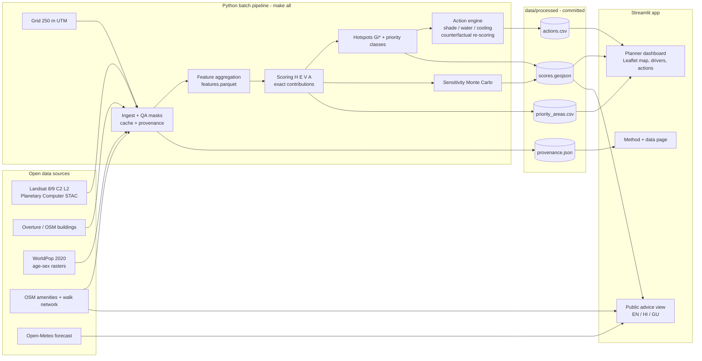

# 06 — Architecture

The AI must render this diagram to `reports/figures/architecture.png` (use `mermaid-cli` via npx if network allows, otherwise `matplotlib`/`graphviz`) and embed it in README, the Method page and the report.

## Design decisions (state them in the report)
- **Batch + static store, thin app:** heavy geospatial work runs once; the app is fast, reproducible and demo-safe offline.
- **Local UTM grid:** metric distances/areas are correct; cells are comparable.
- **Linear composite index:** exact attribution, auditable by non-technical planners.
- **Counterfactual action engine:** actions evaluated by re-running the same scoring, so impact numbers are consistent with the map.
- **Provenance everywhere:** every output carries its source and date.

## Sequence for one planner query (clicking a cell)
1. Streamlit reads the clicked cell id from `streamlit-folium` return value.
2. Looks up the row in cached GeoDataFrame → shows contributions (precomputed, or recomputed instantly with user weights).
3. Looks up actions touching that cell and sensitivity stats.
