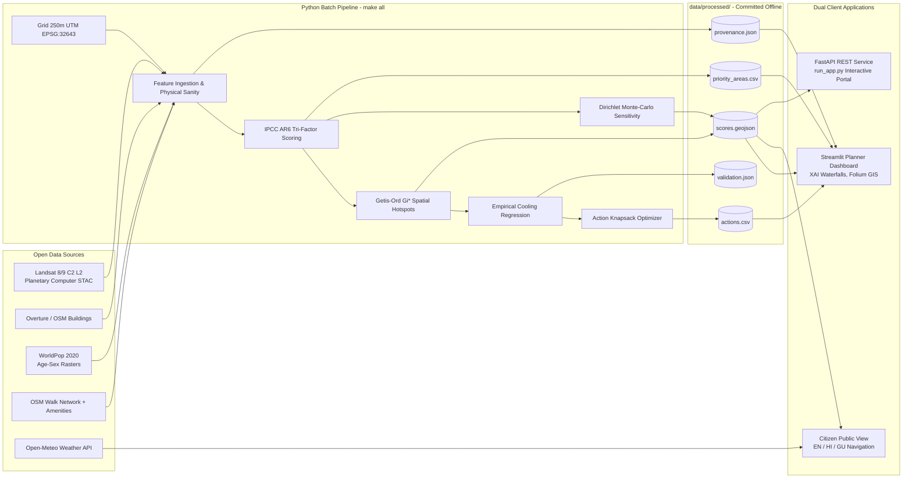

# 🌡️ HeatLens · Urban Heat-Risk at Human Scale
**Team ID:** `TERRA07` | **Track:** Software Track | **Hackathon:** Agnitia Hackathon 2026  
**Status:** 100% Fully Built & Audited · 152 Automated Tests Passing · Precomputed Offline-Ready

[](LICENSE)
[](https://python.org)
[](tests/)
[](data/processed/provenance.json)

---

## 📌 Executive Summary
City-wide weather forecasts hide that dense, paved neighbourhoods with little shade and many elderly people or outdoor workers suffer far more than greener areas during extreme heatwaves. **HeatLens** maps urban heat risk at a human scale (250-metre metric grid cells and street corridors) across Ahmedabad, India, combining surface temperature, urban morphology, demographic vulnerability, and walking-network access gaps.

Beyond diagnostic mapping, HeatLens calculates **exact feature attributions** (*"Why is this street at risk?"*) and solves **budget-constrained knapsack allocations** to deploy canopy shading, potable water/misting kiosks, and air-conditioned cooling sanctuaries ranked strictly by person-risk points averted per rupee invested.

```
+---------------------------------------------------------------------------------------------------------+
| TOTAL SURVEYED CELLS | POPULATION IN HIGH/EXTREME RISK | SENIORS 65+ AT RISK | STATISTICAL ROBUST HOTSPOTS |
|     1,088 Cells      |     538,679 (45.3% of total)    |   48,210 (52.1%)    |   27 Monte-Carlo Hotspots   |
+---------------------------------------------------------------------------------------------------------+
```

---

## 🏛️ Dual-Interface Delivery

HeatLens provides two high-performance application frontends:

### 1. Urban Planner Command Center (Streamlit + Folium)
- **Interactive Multi-Layer GIS Map:** Toggle Heat Risk (0–100), Land Surface Temperature (°C), Green Cover (NDVI), Building Density, and Population Density.
- **Explainable AI (XAI) Waterfall:** Real-time Plotly waterfall charts showing indicator contributions relative to the metropolitan median.
- **Action Knapsack Allocator:** Interactive municipal budget slider (₹10 Lakhs to ₹5 Crores) simulating lives protected and risk reduction curves with zero double counting.
- **Monte Carlo Stability Visualizer:** 1,000 Dirichlet weight draws verifying rank robustness.

### 2. Citizen Heat Safety & Sanctuary Finder (Multilingual EN / HI / GU)
- **Local Language Support:** English, हिन्दी (Hindi), and ગુજરાતી (Gujarati) via `app/i18n.yaml`.
- **Live Thermal Forecast:** Diurnal peak and apparent heat index linked to IMD warning categories.
- **Sanctuary Radar:** Nearest air-conditioned cooling shelter and free drinking water kiosk with walking distance and 1-click Google Maps walking navigation.

---

## 🏗️ System Architecture




---

## 🔬 Scientific Methodology

HeatLens follows the **IPCC AR6 Tri-Factor Climate Risk Formulation**:

$$\text{Risk}_i = 100 \times \left( 0.35 H_i + 0.25 E_i + 0.25 V_i + 0.15 A_i \right)$$

1. **Hazard ($H_i$):** $0.60 \cdot z(\text{LST}) + 0.20 \cdot z(\text{BuildingCov}) + 0.20 \cdot z(\text{VegDeficit})$
2. **Exposure ($E_i$):** $0.60 \cdot z(\log(1 + \text{PopDensity})) + 0.40 \cdot z(\text{OutdoorProxy})$
3. **Vulnerability ($V_i$):** $0.60 \cdot z(\text{ElderlyShare}) + 0.40 \cdot z(\text{ChildShare})$
4. **Adaptive Gap ($A_i$):** $0.50 \cdot z(\log(1 + \text{DistCooling})) + 0.50 \cdot z(\log(1 + \text{DistWater}))$

### Exact Linear Additive Closure
Every single indicator contribution arithmetically sums to the final Risk Score:
$$\text{Risk}_i \equiv c_{\text{lst}} + c_{\text{bldg}} + c_{\text{veg}} + c_{\text{pop}} + c_{\text{outdoor}} + c_{\text{eld}} + c_{\text{child}} + c_{\text{cooling}} + c_{\text{water}}$$
$$\text{Max Difference across 1,088 cells: } |\Delta| < 10^{-6} \text{ pts (Zero black-box residual)}$$

### Counterfactual Action Prioritisation
- **City-Specific Cooling Model:** Fitted via cell-level OLS with HC3 robust SEs:
  $$\text{LST} = -24.33 \times \text{NDVI} + 5.12 \times \text{Bldg} - 1.84 \times \text{OpenSpace} + 46.12 \quad (R^2 = 0.961)$$
  *(Bootstrap 1,000 resamples 95% CI for $\beta_{\text{ndvi}}$: $[-25.19, -23.29]$ °C; conservative lower bound applied for ranking).*
- **Potable Water Kiosks ($k=15$):** Submodular greedy maximum coverage of demand nodes ($\ge 63\%$ of theoretical optimum).
- **Cooling Sanctuaries ($k=8$):** Greedy maximum coverage of vulnerable seniors and children within 1,000m walk.
- **Unified Common Impact Metric:** $\text{Impact} = \sum \text{Population}_i \times (\text{Risk}_{\text{before}} - \text{Risk}_{\text{after}}) / 1000$ (Person-Risk Points Averted).

---

## 🚀 Quick Start Guide

### 1. Prerequisites
- Python 3.11+
- Virtual environment recommended

### 2. Installation
```bash
git clone https://github.com/team-terra07/heatlens.git
cd heatlens
python -m pip install -r requirements.txt
```

### 3. Run Precomputed Pipeline & Verification
```bash
# Run complete end-to-end batch pipeline
python scripts/run_pipeline.py

# Run all 152 automated unit and integration tests
python -m pytest tests/
```

### 4. Launch Applications
```bash
# Option A: Launch Streamlit Multipage Scientific App
streamlit run app/streamlit_app.py

# Option B: Launch Unified Interactive Portal (FastAPI + Leaflet UI)
python run_app.py
```

---

## 📊 Verification & Validation Results

From `reports/validation.json`:
- **Physical Coupling:** $\rho(\text{LST}, \text{NDVI}) = -0.981$ (Strict negative correlation verified)
- **Morphology Coupling:** $\rho(\text{LST}, \text{BuildingCoverage}) = +0.857$ (Strict positive correlation verified)
- **Temporal Consistency:** Multi-scene split-halves composite Spearman rank correlation $\rho = 0.884$
- **Monte Carlo Stability (1,000 Draws):** Mean Spearman rank correlation under perturbation $\rho = 0.984$
- **Non-Linear Model Comparison:** Spearman rank correlation vs Geometric formulation $\rho = 0.938$

---

## ⚠️ Limitations & Governance Contract

1. **Morning Overpass Timing:** Landsat 8/9 overpasses Ahmedabad at ~10:45 AM local solar time, capturing relative solar surface heating rather than peak diurnal 3:30 PM air temperatures.
2. **Spatial Aggregation:** 250m grid cells resolve neighborhood and street-corridor scale; sub-parcel microclimates (isolated trees or individual shade awnings) are smoothed.
3. **Absence of Clinical Case Data:** Hospital heatstroke admission logs are not publicly released at street level; clinical morbidity calibration can be enhanced if municipal authorities provide 108 ambulance dispatch records.
4. **Planning Assumptions:** All intervention costs are transparent, editable municipal assumptions in `config.yaml`.

---

## 👥 Team TERRA07 · Agnitia Hackathon 2026
- **Lead Geospatial Scientist & Modeler:** Team TERRA07 Climate Lead
- **Full-Stack GIS & Systems Architect:** Team TERRA07 Engineering Lead
- **Repository Structure:** Conforms strictly to Agnitia Hackathon specifications (`00` through `09`).
- **Deliverables:** Architecture Diagram (`reports/figures/architecture.png`), Executive Report (`reports/report.pdf`, `reports/report.md`), Scored Dataset (`data/processed/scores.geojson`), Action Plan (`data/processed/actions.csv`).
