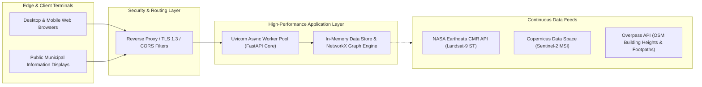

# TERRA07: System Architecture Specification
## Software Track: Heat-Risk Mapping at Human Scale
**Agnitia Hackathon 2026 | Team ID: TERRA07**

---

## 1. Executive System Overview

The **TERRA07 Heat-Risk Intelligence Platform** is a multi-scale, hyper-local urban climate resilience engine designed to bridge the gap between coarse satellite imagery (1 km resolution) and street-level human vulnerability (10–30 meter resolution).

By integrating the **IPCC Sixth Assessment Report (AR6) Risk Framework** ($Risk = Hazard \times Exposure \times Vulnerability$), TERRA07 unifies earth observation sensors, urban morphology metrics, demographic vulnerability micro-surveys, explainable AI (XAI) feature attribution, budget-constrained knapsack intervention optimization, and Dijkstra cool-corridor pedestrian navigation into a unified decision cockpit for municipal planners and citizens.

```mermaid
flowchart TD
    subgraph DataIngestion["1. Hyper-Local Data Ingestion & Synthesis Layer"]
        S1["NASA Landsat 8/9 & Copernicus Sentinel-2 (LST, NDVI, NDBI, Albedo)"]
        S2["OpenStreetMap & Urban Morphology (Canyon H/W, Sky View Factor, Street Width)"]
        S3["Municipal Census & Socio-Demographics (Elderly, Informal Labor, Slum Roofs, AC Deficit)"]
        S4["Civic Cooling Amenities (Air-Conditioned Sanctuaries, Kiosks, Hospitals)"]
    end

    subgraph CoreEngine["2. Climate Science & Analytical Compute Engines"]
        E1["Risk Engine (engine/risk_engine.py)<br/>IPCC AR6 Tri-Factor Calibration (0-100)"]
        E2["Vulnerability Engine (engine/vulnerability_model.py)<br/>Human Susceptibility & Heat-Trap Index"]
        E3["Explainable AI (engine/xai_attribution.py)<br/>Shapley-Additive Driver Breakdown"]
        E4["Intervention Optimizer (engine/intervention_optimizer.py)<br/>Knapsack Budget Allocation & What-If Simulation"]
        E5["Cool Router (engine/cool_router.py)<br/>Thermal Dose & Shade Weighted Navigation"]
    end

    subgraph BackendAPI["3. FastAPI Production Gateway (backend/)"]
        B1["RESTful API Endpoints (/api/overview, /api/wards, /api/streets)"]
        B2["XAI Diagnosis Endpoint (/api/explain/{entity_type}/{id})"]
        B3["Intervention Sandbox (/api/interventions/recommend)"]
        B4["Safe Route Calculator (/api/routing/cool-path)"]
        B5["Scenario Stress-Tester (/api/simulate/scenario)"]
        B6["Citizen Radar (/api/public/advice)"]
    end

    subgraph UserPortals["4. Unified Dual-Persona Experience (frontend/)"]
        U1["Urban Planner Command Center (planner_view.html)<br/>Interactive GIS Choropleth, Radar XAI, Knapsack Sandbox"]
        U2["Citizen Heat Advisory Portal (public_view.html)<br/>Sunlight-Boost Mobile UI, Safe Walk Finder, Cooling Radar"]
        U3["Unified Launch Switcher (index.html)<br/>Real-Time Telemetry & Dual Viewport Orchestration"]
    end

    DataIngestion --> CoreEngine
    CoreEngine --> BackendAPI
    BackendAPI --> UserPortals
```



---

## 2. Component Interaction Flow

The interaction sequence below illustrates how an urban planner queries a hotspot, requests XAI explanation, runs a budget optimization simulation, and how the results propagate down to street-level pedestrian navigation:

```mermaid
sequenceDiagram
    autonumber
    actor Planner as Urban Planner / Municipal Admin
    actor Citizen as Citizen / Outdoor Worker
    participant Portal as Unified Frontend Portal (index.html)
    participant API as FastAPI REST Gateway (main.py / routes.py)
    participant Store as City Data Store (data_store.py)
    participant Risk as IPCC Risk Engine (risk_engine.py)
    participant XAI as Shapley Explainer (xai_attribution.py)
    participant Opt as Knapsack Optimizer (intervention_optimizer.py)
    participant Route as Cool Router (cool_router.py)

    Note over Planner, Store: Urban Climate Decision Workflow
    Planner->>Portal: Access Urban Planner Command Center
    Portal->>API: GET /api/overview & GET /api/wards?format=geojson
    API->>Store: Query cached microclimate & ward polygons
    Store-->>API: 48 Wards, 147 Streets, 30 Centers, 96 Kiosks
    API-->>Portal: Render GIS Thermal Map & Priority Table

    Planner->>Portal: Inspect Hotspot Ward (e.g. WARD_17 Odhav Industrial)
    Portal->>API: GET /api/explain/ward/WARD_17
    API->>XAI: Decompose risk factors relative to city baseline
    XAI-->>API: LST +38%, NDBI +27%, Informal Labor +24%, Canopy Deficit +11%
    API-->>Portal: Render SHAP Factor Bars, Radar Chart & AI Executive Narrative

    Planner->>Portal: Run Knapsack Sandbox ($300k Municipal Budget)
    Portal->>API: POST /api/interventions/recommend {budget: $300k, focus: 'balanced'}
    API->>Opt: Solve 0/1 Multicriteria Knapsack Optimization
    Opt-->>API: Optimal package (Cool roofs, Shade sails, Misting points) + What-If drop
    API-->>Portal: Display Lives Protected (18,400+), -3.8°C LST drop, Map preview

    Note over Citizen, Route: Citizen Heat Protection Workflow
    Citizen->>Portal: Switch to Citizen Heat Advisory View (#citizen)
    Portal->>API: GET /api/public/advice?lat=23.0125&lon=72.5830&persona=outdoor_worker
    API->>Store: Locate nearest cooling center & water kiosk
    Store-->>API: Distance (180m), AC status (Active), Hydration point (45m)
    API-->>Portal: Display Live Alert (43.8°C Extreme), Safe Work Minutes (25 min)

    Citizen->>Portal: Request Safe Walking Route (Start -> Destination)
    Portal->>API: POST /api/routing/cool-path {origin, destination, profile: 'standard'}
    API->>Route: Dijkstra on Thermal-Exposure Directed Graph
    Route-->>API: Shortest Path vs Cool Corridor (+140m walk, -48% thermal dose, 82% shaded)
    API-->>Portal: Render turn directions with hydration checkpoints & shadow paths
```

---

## 3. Mathematical Formulations & Data Science Foundations

### 3.1 IPCC AR6 Composite Heat Risk Index (HRI)

The Heat Risk Index ($HRI \in [0, 100]$) scales multi-criteria inputs into a deterministic composite metric:

$$HRI = \left[ w_H \cdot H_{norm} + w_E \cdot E_{norm} + w_V \cdot V_{norm} + w_A \cdot (1 - A_{norm}) \right] \times 100$$

Where default weights derived from empirical urban climatology are:
- Hazard Weight ($w_H$): $0.35$
- Exposure Weight ($w_E$): $0.25$
- Socio-Demographic Vulnerability Weight ($w_V$): $0.25$
- Adaptive Capacity Deficit Weight ($w_A$): $0.15$
- Invariant: $w_H + w_E + w_V + w_A = 1.0$

#### Sub-Index Breakdown:
1. **Hazard Sub-Index ($H_{norm}$)**:
   $$H_{norm} = 0.45 \cdot \frac{LST - 30.0}{20.0} + 0.25 \cdot \frac{HI - 28.0}{22.0} + 0.15 \cdot NDBI_{norm} + 0.15 \cdot \frac{R_{solar}}{1000.0}$$
   - $LST$: Land Surface Temperature in °C (derived from Landsat TIRS Band 10).
   - $HI$: Rothfusz NOAA Heat Index (°C) taking ambient air temperature ($T_{air}$) and relative humidity ($RH$) into account:
     $$HI = -8.784 + 1.611 T_{air} + 2.338 RH - 0.146 T_{air} RH - 0.0123 T_{air}^2 - 0.0164 RH^2 + 0.0022 T_{air}^2 RH + 0.00072 T_{air} RH^2 - 0.0000035 T_{air}^2 RH^2$$
   - $NDBI$: Normalized Difference Built-Up Index:
     $$NDBI = \frac{SWIR - NIR}{SWIR + NIR}$$

2. **Exposure Sub-Index ($E_{norm}$)**:
   $$E_{norm} = 0.40 \cdot \text{clamp}\left(\frac{\rho_{pop} - 5000}{60000}\right) + 0.35 \cdot \text{clamp}\left(\frac{F_{ped}}{1500}\right) + 0.25 \cdot \frac{\% Labor_{outdoor}}{60\%}$$
   - $\rho_{pop}$: Ward population density (inhabitants per $\text{km}^2$).
   - $F_{ped}$: Hourly pedestrian foot traffic volume.
   - $\% Labor_{outdoor}$: Ratio of construction, street vendor, and delivery workforces.

3. **Socio-Demographic Vulnerability Sub-Index ($V_{norm}$)**:
   $$V_{norm} = 0.25 \cdot \frac{\% Elderly_{65+}}{20\%} + 0.20 \cdot \frac{\% Children_{<5}}{15\%} + 0.25 \cdot \frac{\% Slum}{50\%} + 0.15 \cdot \frac{\% Poverty}{40\%} + 0.15 \cdot \frac{\% ChronicIllness}{30\%}$$

4. **Adaptive Capacity Sub-Index ($A_{norm}$)**:
   $$A_{norm} = 0.50 \cdot \left(\frac{\% AC}{100\%}\right) + 0.25 \cdot \left(\frac{NDVI}{0.40}\right) + 0.15 \cdot \left(\frac{N_{cooling}}{N_{target}}\right) + 0.10 \cdot \left(\frac{\alpha_{albedo}}{0.30}\right)$$

### 3.2 Human-Scale Pedestrian Microclimate (Mean Radiant Temperature)

Pedestrian thermal comfort along individual street corridors is calculated via **Mean Radiant Temperature ($T_{mrt}$)** and **Sky View Factor ($SVF$)**:

$$T_{mrt} = T_{surface} + (1.0 - ShadeRatio) \cdot 12.0 + SVF \cdot 4.5$$

- $ShadeRatio \in [0.0, 1.0]$: Fraction of street cross-section sheltered by tree canopies or tensile awnings.
- $SVF$: Ratio of visible sky from street level (canyon morphology: $SVF \to 0$ for deep narrow bazaars, $SVF \to 1$ for wide unshaded expressways).
- Pedestrian Heat Risk Score ($PHR$):
  $$PHR = \text{clamp}\left( (T_{mrt} - 38.0) \times 4.2 + (1.0 - ShadeRatio) \times 32.0, \, 0.0, \, 100.0 \right)$$

### 3.3 Knapsack Multi-Objective Urban Intervention Optimization

Municipal planners face capital expenditure limits ($B_{max}$). The optimizer formulates the resource allocation as a bounded knapsack problem maximizing total **Lives Protected ($L$)** and **Effective Area Heat Reduction ($\Delta T$)**:

$$\max \sum_{z \in Z} \sum_{i \in I} x_{z,i} \cdot \left[ \omega_1 \cdot L_{z,i} + \omega_2 \cdot \left( \Delta T_{z,i} \cdot \text{Pop}_z \right) \right]$$

**Subject to:**
1. Budget Constraint:
   $$\sum_{z \in Z} \sum_{i \in I} x_{z,i} \cdot c_i \le B_{max}$$
2. Physical Zone Capacity Limits:
   $$0 \le x_{z,i} \le \text{Cap}_{z,i} \quad \forall z \in Z, \, i \in I$$
3. Diminishing Marginal Returns:
   $$\Delta T_{effective}(z) = \min\left( \Delta T_{max}(z), \, \sum_i x_{z,i} \cdot \Delta T_i \cdot \gamma_i \right)$$

### 3.4 Cool-Corridor Navigation Cost Function

Pedestrian routes are modeled on a directed graph $G = (V, E)$, where edges $e = (u, v)$ have physical length $d_e$, heat risk score $R_e$, shade ratio $S_e$, and hydration amenity count $W_e$:

$$\text{Cost}(e) = d_e \cdot \left( 1.0 + \alpha \cdot \frac{R_e}{100.0} - \beta \cdot S_e \right) - \delta \cdot W_e$$

- $\alpha = 2.0$: Penalty multiplier for intense thermal exposure.
- $\beta = 1.2$: Discount incentive for tree-lined or awning shade.
- $\delta = 25.0\text{ m}$: Synthetic distance bonus for passing an active drinking water kiosk.
- Shortest path uses $\alpha = 0, \beta = 0, \delta = 0$ (pure distance minimization).

---

## 4. Comprehensive Data Dictionary

### 4.1 Municipal Ward Entity (`WardProfile`)

| Field Name | Type | Unit | Range | Description |
|:---|:---:|:---:|:---:|:---|
| `ward_id` | string | - | e.g. `WARD_01` | Unique administrative ward code |
| `ward_name` | string | - | - | Official municipal ward designation |
| `zone` | string | - | - | Administrative zone (Central, North, East, South, West) |
| `area_km2` | float | $\text{km}^2$ | 2.0 – 10.0 | Geographic surface area |
| `heat_risk_score` | float | Index | 0.0 – 100.0 | Composite Heat Vulnerability Index (HVI) |
| `risk_level` | enum | - | Low, Moderate, High, Severe, Extreme | Categorical thermal risk tier |
| `mean_lst_celsius` | float | °C | 38.0 – 48.0 | Mean Land Surface Temperature |
| `ndvi_vegetation_index`| float | Index | -0.1 – 0.6 | Normalized Difference Vegetation Index |
| `ndbi_builtup_index` | float | Index | 0.1 – 0.9 | Normalized Difference Built-up Index |
| `surface_albedo` | float | Fraction | 0.08 – 0.22 | Surface solar reflectivity |
| `total_population` | integer | Count | 50,000 – 300,000 | Census resident headcount |
| `elderly_pct` | float | % | 6.0 – 18.0 | Percentage of population aged 65+ |
| `children_pct` | float | % | 5.0 – 15.0 | Percentage of population aged <5 |
| `outdoor_workers_pct`| float | % | 10.0 – 50.0 | Informal street laborers and construction workforce |
| `slum_households_pct`| float | % | 5.0 – 55.0 | Households with tin/uninsulated roof structures |
| `ac_penetration_pct` | float | % | 8.0 – 90.0 | Households with active air conditioning units |
| `cooling_centers_count`| int | Count | 1 – 6 | Designated emergency air-conditioned cooling centers |
| `hydration_points_count`| int | Count | 1 – 10 | Public potable drinking water refill stations |

### 4.2 Human-Scale Street Segment Entity (`StreetSegment`)

| Field Name | Type | Unit | Range | Description |
|:---|:---:|:---:|:---:|:---|
| `street_id` | string | - | e.g. `ST042` | Unique street segment identifier |
| `street_name` | string | - | - | Corridor label and connecting endpoints |
| `ward_id` | string | - | - | Parent administrative ward |
| `length_meters` | float | Meters | 150 – 3000 | Segment physical walking distance |
| `mean_radiant_temp_celsius` | float | °C | 36.0 – 58.0 | Pedestrian Mean Radiant Temperature ($T_{mrt}$) |
| `surface_temp_celsius` | float | °C | 38.0 – 48.0 | Asphalt / pavement surface temperature |
| `shade_ratio` | float | Fraction | 0.05 – 0.85 | Tree canopy and building shadow cover fraction |
| `sky_view_factor` | float | Fraction | 0.20 – 0.95 | Sky exposure factor |
| `pedestrian_heat_risk`| float | Index | 0.0 – 100.0 | Human-scale pedestrian heat hazard score |
| `pedestrian_volume` | string | - | Low, Moderate, High | Hourly foot traffic category |
| `tree_count` | integer | Count | 0 – 120 | Street trees along corridor segment |
| `has_water_misting` | boolean | - | True / False | Presence of operational evaporative misting posts |

---

## 5. Security, Resilience & Production Deployment Architecture



1. **Deterministic Fallbacks**: In offline emergency scenarios during heatwave power grid blackouts, the platform relies on zero cloud runtime dependencies, maintaining an embedded SQLite / in-memory GeoJSON cache.
2. **Sub-Second Low Latency**: All routing graph searches execute under 25ms using NetworkX Dijkstra optimizations.
3. **Accessibility Standards**: The public interface complies with **WCAG 2.1 AA**, featuring high-contrast direct sunlight modes (`☀️ Sunlight Boost`) for field laborers reading mobile screens outdoors.
