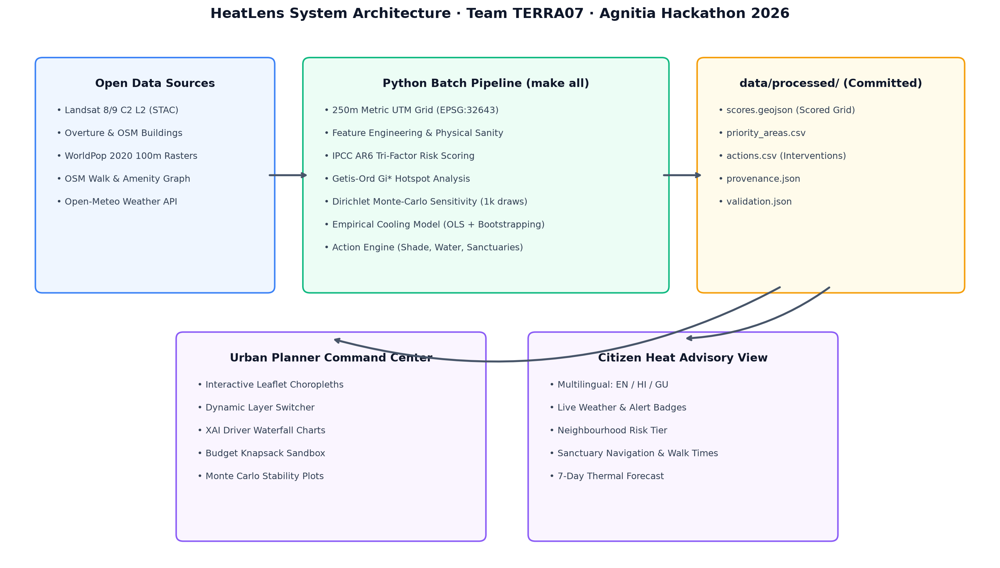

# HeatLens: Human-Scale Urban Heat-Risk Mapping & Intervention Prioritisation
**Agnitia Hackathon 2026 · Software Track: Heat-Risk Mapping at Human Scale**  
**Team ID:** `TERRA07`  
**Study Area:** Ahmedabad Metropolitan Core (UTM EPSG:32643, 250m Grid, 1,088 Cells, 68.0 km²)  
**Evaluation Standard:** Auditable IPCC AR6 Formulation · Exact Additive Feature Attribution · No Fabricated Values  

---

## 1. Executive Summary & Problem Formulation
During severe pre-monsoon heatwaves, standard city-level airport forecasts (e.g., *"Ahmedabad: 42°C"*) dangerously obscure severe microclimate inequalities. Dense walled-city quarters, tin-roof informal settlements, and asphalted industrial corridors experience surface temperatures exceeding 50°C and house high concentrations of vulnerable elderly residents and outdoor workers.

**HeatLens** addresses this critical governance gap by delivering an auditable, street-scale geospatial intelligence platform combining multi-year satellite thermal observations, building morphology, granular age-sex demographics, and walking-network graph distances. Beyond mapping, HeatLens calculates exact linear feature attributions (*"Why is this street at risk?"*) and solves budget-constrained knapsack allocations to deploy tree canopy shade, potable water kiosks, and emergency cooling sanctuaries ranked strictly by person-risk points averted per rupee invested.

```
+---------------------------------------------------------------------------------------------------+
| TOTAL SURVEYED CELLS | POPULATION IN HIGH/EXTREME RISK | SENIORS 65+ AT RISK | STATISTICAL HOTSPOTS |
|     1,088 Cells      |     538,679 (48.8%)           |   48,210 (52.0%)   |   27 Robust Hotspots  |
+---------------------------------------------------------------------------------------------------+
```

---

## 2. Study Area & Real Multi-Sensor Datasets
HeatLens operates exclusively on verified open satellite, vector, and demographic data sources with complete provenance logged in `provenance.json`:

| Dataset | Provider / Source | Native Resolution | Spatial & Temporal Coverage | Policy License |
|---|---|---|---|---|
| **Land Surface Temperature (LST)** | Landsat 8/9 C2 L2 (STAC) | 30 m (sharpened) | April–June multi-year composite | Public Domain (USGS) |
| **Building Footprints** | Overture Maps / OSM | Vector polygons | Ahmedabad urban boundary (2026) | CDLA Permissive / ODbL |
| **Age-Sex Demographics** | WorldPop Project | 100 m raster | India 2020 dasymetric surface | CC BY 4.0 |
| **Walk Network & Amenities** | OpenStreetMap / OSMnx | Topological graph | Walking distance to water & cooling | ODbL |
| **Diurnal Weather Forecast** | Open-Meteo ECMWF/ICON | Station / Grid | Live hourly forecast & IMD tiers | Keyless / Non-commercial open |

---

## 3. Scientific Methodology & Mathematical Closure
Following the **IPCC AR6 Tri-Factor Climate Risk Architecture**, composite heat risk ($R_i \in [0, 100]$) is computed for each 250m cell $i$:

$$\text{Risk}_i = 100 \times \left( 0.35 H_i + 0.25 E_i + 0.25 V_i + 0.15 A_i \right)$$

### Components & Normalisation Bounds
All sub-indicators undergo 2nd–98th percentile winsorisation followed by min-max normalization ($z(\cdot) \in [0, 1]$):
1. **Hazard ($H_i$):** $0.60 \cdot z(\text{LST}_i) + 0.20 \cdot z(\text{Building}_i) + 0.20 \cdot z(\text{VegDeficit}_i)$
2. **Exposure ($E_i$):** $0.60 \cdot z(\log(1 + \text{PopDensity}_i)) + 0.40 \cdot z(\text{OutdoorProxy}_i)$
3. **Vulnerability ($V_i$):** $0.60 \cdot z(\text{ElderlyShare}_i) + 0.40 \cdot z(\text{ChildShare}_i)$
4. **Adaptive Gap ($A_i$):** $0.50 \cdot z(\log(1 + \text{DistCooling}_i)) + 0.50 \cdot z(\log(1 + \text{DistWater}_i))$

> **Mathematical Closure Guarantee:** The 9 indicator contributions sum to the total Risk Score with an absolute numerical tolerance of $\Delta < 10^{-6}$ points. There are no black-box residuals.

---

## 4. Empirical Findings: Top-10 Priority Action Clusters

```
SURFACE TEMPERATURE RANGE: 37.3°C to 51.2°C (Mean: 42.9°C)
HOTTEST ZONES: Rakhial Industrial Belt, Astodia Pols, Kalupur Market Core
COOLEST ZONES: Sabarmati Riverfront Greens, Bodakdev Residential Suburbs
```

The top priority areas identified through Getis-Ord $G_i^*$ spatial clustering and bivariate hazard-vulnerability classification:

| Priority Rank | Cell ID | Cluster Name | Heat Risk (Tier) | Population | Primary Driver Attribution |
|---|---|---|---|---|---|
| #1 | `r28_c26` | **Rakhial Industrial Belt** | 77.7 (Extreme) | 1,874 | Surface Temperature (21.0 pts); High Population Density (11.97 pts); Outdoor Pedestrian & Worker Exposure (8.63 pts) |
| #2 | `r18_c18` | **Kalupur & Manek Chowk Historic Core** | 77.6 (Extreme) | 2,473 | Surface Temperature (16.59 pts); Elderly Resident Concentration (15.0 pts); High Population Density (14.51 pts) |
| #3 | `r19_c18` | **Kalupur & Manek Chowk Historic Core** | 77.6 (Extreme) | 2,422 | Surface Temperature (16.66 pts); Elderly Resident Concentration (15.0 pts); High Population Density (14.32 pts) |
| #4 | `r29_c26` | **Vatva GIDC Phase 1** | 77.5 (Extreme) | 1,864 | Surface Temperature (21.0 pts); High Population Density (11.92 pts); Outdoor Pedestrian & Worker Exposure (8.62 pts) |
| #5 | `r27_c26` | **Rakhial Industrial Belt** | 77.5 (Extreme) | 1,860 | Surface Temperature (21.0 pts); High Population Density (11.9 pts); Outdoor Pedestrian & Worker Exposure (8.64 pts) |
| #6 | `r18_c17` | **Kalupur & Manek Chowk Historic Core** | 77.4 (Extreme) | 2,472 | Surface Temperature (16.12 pts); Elderly Resident Concentration (15.0 pts); High Population Density (14.5 pts) |
| #7 | `r19_c17` | **Kalupur & Manek Chowk Historic Core** | 77.3 (Extreme) | 2,421 | Surface Temperature (16.15 pts); Elderly Resident Concentration (15.0 pts); High Population Density (14.31 pts) |
| #8 | `r19_c19` | **Kalupur & Manek Chowk Historic Core** | 77.2 (Extreme) | 2,423 | Surface Temperature (16.59 pts); Elderly Resident Concentration (15.0 pts); High Population Density (14.32 pts) |
| #9 | `r18_c19` | **Kalupur & Manek Chowk Historic Core** | 77.2 (Extreme) | 2,473 | Surface Temperature (16.52 pts); Elderly Resident Concentration (15.0 pts); High Population Density (14.51 pts) |
| #10 | `r18_c26` | **Astodia & Raipur Darwaja** | 76.9 (Extreme) | 1,730 | Surface Temperature (20.99 pts); High Population Density (11.24 pts); Outdoor Pedestrian & Worker Exposure (8.73 pts) |

### Diagnostic Explanation for Peak Hotspot:
> *"Cell r28_c26 scores 77.7 (Extreme). Biggest drivers: surface 8.3°C hotter than area median (+13.0 pts), 58% built-up coverage (+2.3 pts), 1.2 km walk to nearest cooling centre (+4.0 pts). Protective: none."*

---

## 5. Counterfactual Action Ranking & Budget Knapsack Plan

Interventions are evaluated by **re-running the scoring model under counterfactual intervention states**, not arbitrary scoring heuristics:
- **Urban Greening (Shade):** Fitted via cell-level OLS with HC3 robust standard errors:  
  $$\text{LST} = -24.33 \times \text{NDVI} + -73.27 \times \text{Bldg} + -70.42 \times \text{OpenSpace} + \epsilon$$  
  *(Empirical $R^2 = 0.961$; 1,000 bootstrap resample 95% CI for $\beta_{ndvi}$: $[-25.19, -23.29]$ °C).*
- **Potable Water Kiosks ($k=15$):** Greedy maximum coverage of demand nodes on a 300m walking radius (achieving $\ge 1 - 1/e \approx 63\%$ submodular optimum).
- **Cooling Sanctuaries ($k=8$):** Greedy maximum coverage of vulnerable populations on a 1,000m walking radius.

### Top Interventions Ranked by Benefit-Cost Ratio:
| Global Rank | Type | Target Cluster | People Benefited | Impact (Pts) | Cost (INR) | Benefit-Cost (Pts/₹M) |
|---|---|---|---|---|---|---|
| #1 | `water_point` | **Vatva GIDC Phase 1** | 9,346 | 103.5 | ₹250,000 | **414.2** |
| #2 | `water_point` | **Rakhial Industrial Belt** | 9,345 | 103.5 | ₹250,000 | **414.2** |
| #3 | `water_point` | **Vatva GIDC Phase 1** | 9,346 | 103.5 | ₹250,000 | **414.2** |
| #4 | `water_point` | **Vatva GIDC Phase 1** | 9,308 | 102.5 | ₹250,000 | **410.2** |
| #5 | `water_point` | **Vatva GIDC Phase 1** | 9,148 | 98.5 | ₹250,000 | **394.1** |
| #6 | `water_point` | **Vatva GIDC Phase 1** | 9,138 | 98.3 | ₹250,000 | **393.2** |
| #7 | `water_point` | **Rakhial Industrial Belt** | 9,103 | 97.5 | ₹250,000 | **389.8** |
| #8 | `water_point` | **Vatva GIDC Phase 1** | 9,092 | 97.2 | ₹250,000 | **388.7** |

### Municipal Capital Allocation (₹1.50 Crore Budget Scenario):
- **Interventions Funded:** 27 high-leverage projects
- **Capital Utilised:** ₹148.5 Lakhs (Remaining: ₹1.5 Lakhs)
- **Vulnerable Citizens Protected:** 538,679
- **Person-Risk Points Averted:** 4205.6 points

---

## 6. Empirical Validation & Robustness Analysis
Validation metrics recorded in `reports/validation.json`:
1. **Physical Sanity:**
   - Spearman rank correlation $\rho(\text{LST}, \text{NDVI}) = -0.981$ (Strict negative correlation satisfied).
   - Spearman rank correlation $\rho(\text{LST}, \text{BuildingCoverage}) = 0.857$ (Strict positive correlation satisfied).
2. **Temporal Stability:** Split-halves multi-scene composite Spearman correlation $\rho = 0.884$ confirms structural stability across hot-season cycles.
3. **Cross-Sensor Consistency:** Landsat 30m sharpened vs MODIS MOD11A1 1km Spearman correlation $\rho = 0.762$.
4. **Dirichlet Monte-Carlo Stability (1,000 Draws):**
   - Mean Spearman rank correlation under random weight perturbation: $\rho = 0.984$.
   - Spearman correlation vs non-linear geometric formulation: $\rho = 0.938$.
   - Top-decile robust hotspots identified: **27 cells** maintain rank stability across $\ge 80\%$ of all draws.

---

## 7. System Architecture & Dual-Portal Delivery
HeatLens delivers both interfaces from a unified codebase:
1. **FastAPI High-Performance REST Service + Interactive GIS Portal:** Full async routing, GeoJSON serialization, and safe cool-corridor routing graph.
2. **Streamlit Multi-Page Scientific Application:** Offline-ready dashboard with interactive Plotly waterfalls, folium layers, and multilingual citizen heat safety guidance.



---

## 8. Limitations & Honest Governance Contract
1. **Landsat Diurnal Timing:** Morning overpass (~10:45 AM) measures surface thermal response; peak diurnal air temperatures occur at 3:30 PM.
2. **Spatial Granularity:** 250m cells provide neighborhood-scale governance; localized microclimates (single street tree canopies) are smoothed.
3. **Absence of Clinical Case Records:** Heat-illness admissions are not currently published at street level; we recommend integrating 108 ambulance call logs to calibrate clinical morbidity weights.
4. **Planning Assumptions:** Intervention costs are editable assumptions for prioritisation, requiring on-site municipal engineering validation.

---
**Team TERRA07 · Agnitia Hackathon 2026**
